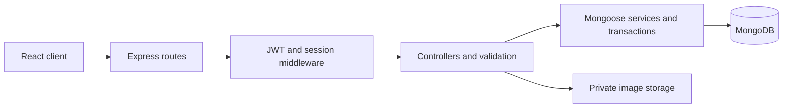

# ReviewRoom

A design review studio built with **MongoDB, Express, React, and Node.js**.

Upload a design, collect feedback at specific points, link a revision to each fix, and get the final version approved. The interface uses cream, dusty rose, sage, and paper-inspired details.

Built for [Mallika’s personal account](https://github.com/snowhiteohno). The repository is public. The application runs locally and has not been published through another hosting account.

## Three features to try

### Feedback to fix

Feedback can be a suggestion or a must fix. A designer links a later revision to show how they addressed it. Another reviewer verifies that revision.

Must fix items stay visible across versions. Approval is blocked until every must fix in the project is verified. The server enforces this rule inside a MongoDB transaction.

### Blind design voting

Choose two or three uploaded versions and ask the team to pick a direction. Each account gets one vote. Counts stay hidden until that person votes or the poll closes, including for owners and editors.

The results use a MongoDB aggregation pipeline. A compound unique index prevents duplicate votes, and membership checks protect the results.

### Before and after reveal

Select two revisions and drag a divider to reveal what changed. The slider supports touch, mouse, and keyboard controls. Images with different proportions are fitted to a shared frame without being stretched.

## Other working features

- Registration, login, logout, and persistent sessions.
- bcrypt password hashes and JWT authentication in HttpOnly cookies.
- Protected routes, project membership, and owner, editor, and reviewer permissions.
- Private image uploads with size, format, and dimension validation.
- Version history with safe numbering during concurrent uploads.
- Pinned comments, threaded replies, and resolved discussions.
- Side by side comparison, canvas zoom, and responsive pin coordinates.
- Project categories, search, filters, favorites, grid and list views, and archiving.
- Project activity, studio activity, and automatic refreshes while the page is visible.
- Loading, error, and empty states, native dialogs, and reduced motion support.

The starter projects and sample comments are labeled as samples. Their artwork is original SVG illustration included in this repository. Sample studios are created once per account, including when initialization requests arrive together.

## Stack

| Layer          | Technology                                              |
| -------------- | ------------------------------------------------------- |
| Client         | React 19, TypeScript, Vite, React Router                |
| Styling        | CSS, system fonts, Lucide icons                         |
| Server         | Node.js, Express 5, MVC folders                         |
| Database       | MongoDB with Mongoose                                   |
| Authentication | bcrypt, jsonwebtoken, cookie-parser, revocable sessions |
| Uploads        | Multer, Sharp, private filesystem storage               |
| Validation     | Zod, Mongoose schemas, database indexes                 |
| Testing        | Node test runner, Supertest, Playwright                 |

No AI API key or paid API is needed.

## Run locally

Requires Node.js 22.13 or newer and npm. Choose either a local MongoDB Community installation with mongod on your PATH, or a MongoDB Atlas connection.

```sh
npm ci
npm run dev
```

Open **http://localhost:5174**, create an account, and start exploring. There are no hardcoded accounts or shared passwords.

With no MONGODB_URI set, the development script starts a dedicated local MongoDB replica set on port 27019. It stores database files under the ignored .data/mongo directory. It does not change another MongoDB service. A matching ReviewRoom instance already on that port is reused.

The development script starts the Express API on port 5180 and the React client on port 5174. Vite proxies API requests so cookies stay on the same origin.

### Use MongoDB Atlas instead

Copy .env.example to .env and fill in MONGODB_URI with your own Atlas connection string. Then run npm run dev. Local MongoDB startup is skipped when a URI is provided.

Use a replica set or Atlas. ReviewRoom uses transactions to keep feedback, approvals, membership changes, votes, and version numbers consistent.

### Local data

- .data/mongo: local MongoDB data.
- .data/uploads: private uploaded images.
- .data/session-secret: a generated development-only signing secret.
- .data/mongod.log: local MongoDB logs.

These paths, .env files, test artifacts, and browser screenshots are ignored by Git. Local data survives application restarts.

## A demo you can present

1. Register a designer account and a reviewer account in separate browser profiles.
2. Create a project and upload a design.
3. Add the reviewer’s email through Share, then send them the copied link.
4. As the reviewer, pin a Must fix comment on the design.
5. As the designer, upload a revision and open Fixes.
6. Select Link a fix and choose the later revision.
7. Request a review. Approval stays disabled until verification.
8. As the reviewer, verify the linked revision and approve it.
9. Open Compare and switch to Reveal changes.
10. Open Votes, start a blind vote, and show how results appear after voting.

A sample Flora project includes two revisions, an addressed sample fix, and a blind vote so you can explore these features immediately.

## Roles

| Action                          | Owner | Editor                   | Reviewer |
| ------------------------------- | ----- | ------------------------ | -------- |
| View designs and feedback       | Yes   | Yes                      | Yes      |
| Comment and reply               | Yes   | Yes                      | Yes      |
| Upload revisions and link fixes | Yes   | Yes                      | No       |
| Request review or reopen draft  | Yes   | Yes                      | No       |
| Approve or request changes      | Yes   | No                       | Yes      |
| Verify another person’s fix     | Yes   | Original feedback author | Yes      |
| Manage access or archive        | Yes   | No                       | No       |
| Start a blind vote              | Yes   | Yes                      | No       |
| Vote once in a poll             | Yes   | Yes                      | Yes      |
| Close a poll                    | Yes   | Poll creator             | No       |

A person cannot verify their own fix. Ordinary suggestions can be resolved directly by an editor, owner, or their author. Must fix items require the linked-revision verification flow.

Sharing records access; it does not send email. The teammate registers or signs in with the email added to the project. Removing membership immediately removes access to files and project operations.

## How it works



The server loads the signed-in account from a verified JWT and a live session record. Client-supplied identity headers are ignored. Logout deletes that session, so replaying its old cookie no longer works.

Projects have embedded membership records. Versions, comments, polls, votes, favorites, and activity reference their parent records through Mongoose models. Uploaded bytes are outside the public directory and are returned only after checking project access.

Every project mutation first writes the project’s revision inside a transaction. Concurrent writes therefore conflict and retry safely. Approval checks and feedback verification run in that same transaction, preventing a competing blocker from being ignored.

Version numbers use a project counter protected by the transaction and a unique project-number index. Failed database operations remove the newly written image file.

Pinned coordinates are normalized from zero to one relative to the image. They remain aligned while the canvas resizes and zooms.

## Syllabus map

| MERN concept                      | Where ReviewRoom uses it                                                |
| --------------------------------- | ----------------------------------------------------------------------- |
| React components and props        | Studio, review canvas, forms, and reusable feedback components          |
| Controlled forms and validation   | Registration, login, projects, feedback, voting, and sharing            |
| Hooks, refs, and events           | Pin placement, canvas zoom, comparison slider, and refresh logic        |
| Context and protected routing     | AuthProvider and React Router login redirects                           |
| Fetch and REST APIs               | Client requests to Express routes                                       |
| Node.js and environment variables | Runtime configuration, development tools, and private file storage      |
| Express MVC and middleware        | Routes, controllers, authentication, origin checks, uploads, and errors |
| MongoDB and Mongoose              | Models, validation, references, indexes, and queries                    |
| Aggregation                       | Grouping blind votes into result counts                                 |
| Authentication and authorization  | bcrypt, JWTs, HttpOnly cookies, sessions, and project roles             |
| CRUD and business rules           | Projects, members, feedback states, revisions, and approvals            |
| Transactions and concurrency      | Safe version numbering, approval gates, and duplicate voting protection |

## API overview

| Method       | Endpoint                              | Purpose                                       |
| ------------ | ------------------------------------- | --------------------------------------------- |
| POST         | /api/auth/register                    | Create an account                             |
| POST         | /api/auth/login                       | Start a session                               |
| GET          | /api/auth/me                          | Read the signed-in account                    |
| POST         | /api/auth/logout                      | Revoke the current session                    |
| GET          | /api/studio                           | List accessible projects and activity         |
| POST         | /api/studio                           | Initialize a sample studio once               |
| POST         | /api/projects                         | Create a project                              |
| GET          | /api/projects/:id                     | Read a project, versions, feedback, and polls |
| PATCH        | /api/projects/:id                     | Edit or archive a project                     |
| PUT          | /api/projects/:id/favorite            | Change a personal favorite                    |
| POST, DELETE | /api/projects/:id/members             | Add, update, or remove access                 |
| POST         | /api/projects/:id/upload              | Upload a revision                             |
| GET          | /api/assets/:id                       | Read an authorized image                      |
| POST         | /api/projects/:id/comments            | Add feedback or a reply                       |
| PATCH        | /api/projects/:id/comments/:commentId | Resolve, reopen, address, or verify feedback  |
| POST         | /api/projects/:id/review              | Request review or make a review decision      |
| POST         | /api/projects/:id/polls               | Start a design vote                           |
| POST         | /api/projects/:id/polls/:pollId/votes | Cast one vote                                 |
| PATCH        | /api/projects/:id/polls/:pollId/close | Close voting and reveal results               |

## Tests and checks

```sh
npm run typecheck
npm run build
npm test
```

The API suite uses Supertest and a real MongoDB replica set. It creates a uniquely named reviewroom_test database, checks its name before cleanup, and drops only that database. It covers password hashing, session revocation, access controls, private files, concurrent uploads, feedback isolation, independent verification, approval races, blind voting, cross-project options, membership removal, and idempotent sample setup.

For browser tests, keep npm run dev running and start Chrome with remote debugging enabled:

```sh
npm run test:ui
```

CHROME_CDP_URL defaults to http://localhost:9222. UI_BASE_URL defaults to http://localhost:5174. The browser suite uses separate temporary browser contexts for a designer and reviewer. It tests registration, login and logout, uploads, sharing, linked fixes, approval blocking, verification, voting, keyboard slider controls, mobile layout, and persistence after signing in again.

Screenshots are saved under artifacts. Test-created browser accounts use generated reviewroom.test email addresses. Their uploaded test project is archived on a successful run.

## Production build

```sh
npm run build
NODE_ENV=production npm start
```

Set MONGODB_URI, APP_ORIGIN, and a random JWT_SECRET of at least 32 characters in the hosting environment. Production authentication cookies require HTTPS. Use persistent storage for UPLOAD_DIR and keep it outside public static files. Express serves the compiled React client and API from the same origin.

The application is currently kept local, as requested. No external hosting account is required for development.

## Source layout

```text
client/src/
  App.tsx, AuthPage.tsx       Routing and authentication screens
  Studio.tsx, Review.tsx     Project board and review canvas
  components/                Forms, feedback flow, design votes, comparison
  lib/                       Auth context, typed data, API adapter
server/
  config/                    Environment and MongoDB setup
  models/                    Mongoose schemas and indexes
  controllers/               Authentication and product operations
  middleware/                JWT sessions and request origin checks
  routes/                    Express endpoints
  services/                  Authorization, transactions, samples, vote results
  utils/                     Validation and error responses
scripts/
  dev.mjs, mongo.mjs          Local development and database startup
  ui-check.mjs               Two-account browser verification
tests/
  api.test.mjs               MongoDB and Express integration tests
```

## Scope

This release reviews images and screenshots. Email delivery, email ownership verification, password recovery, PDF markup, and video review are outside this version. The class repository’s complete end-term guidelines have not been supplied, so submission-specific requirements still need to be checked against that document.
