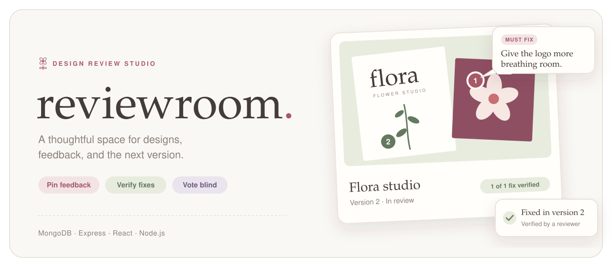
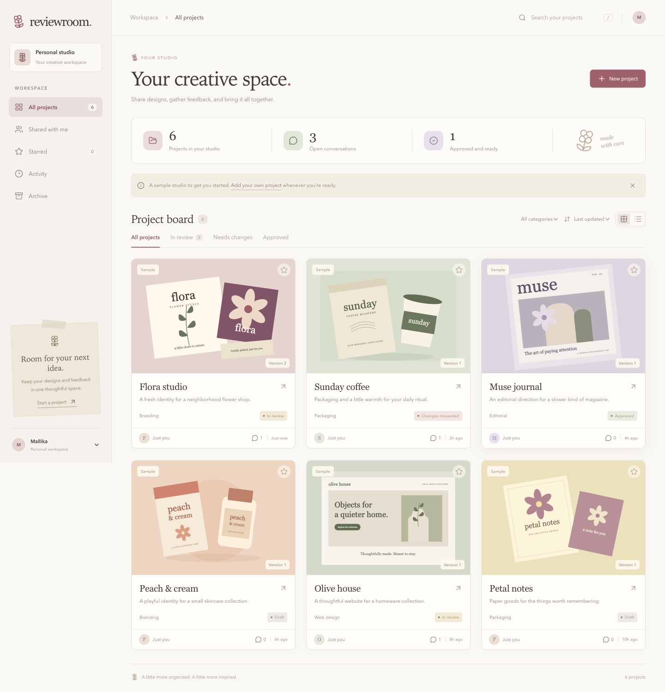
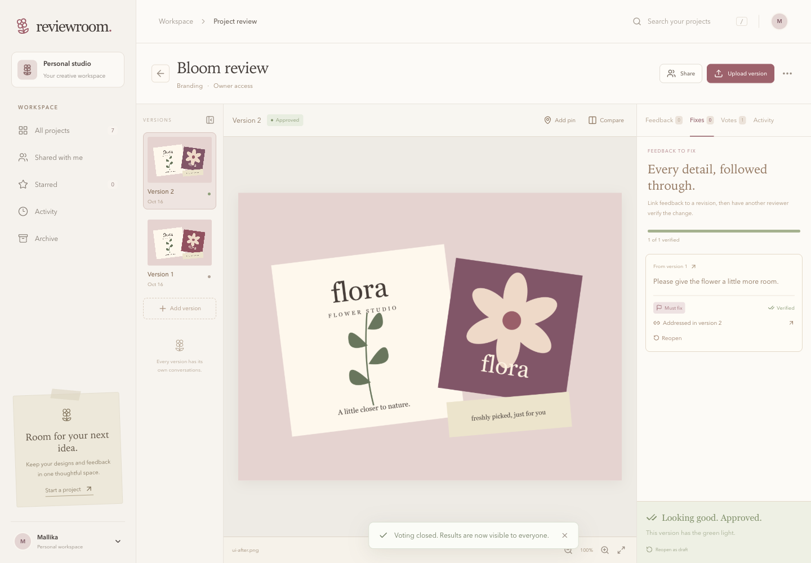
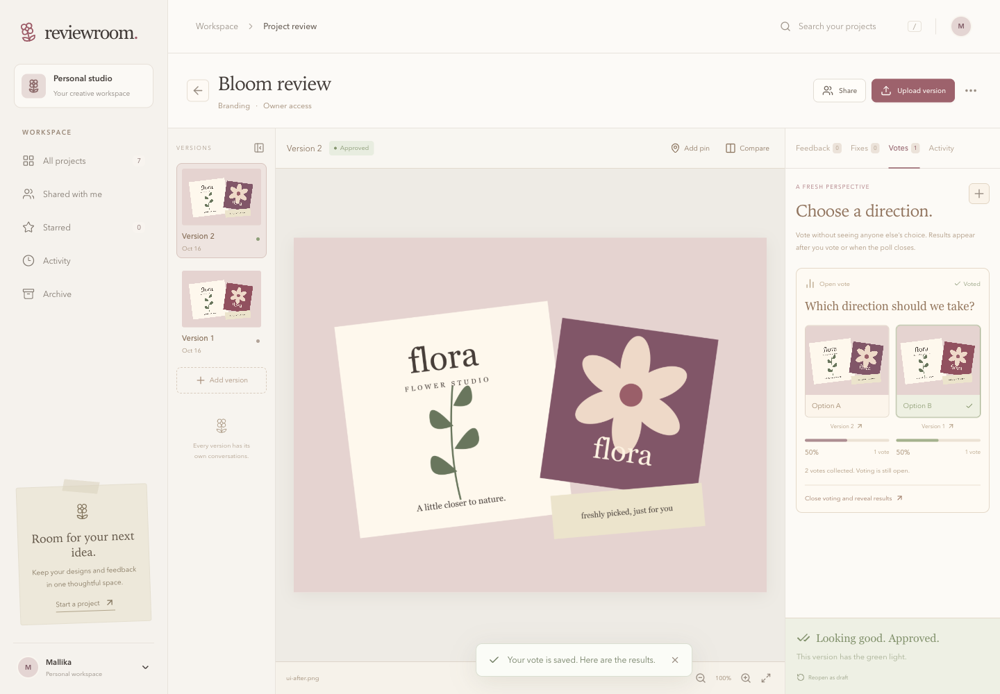
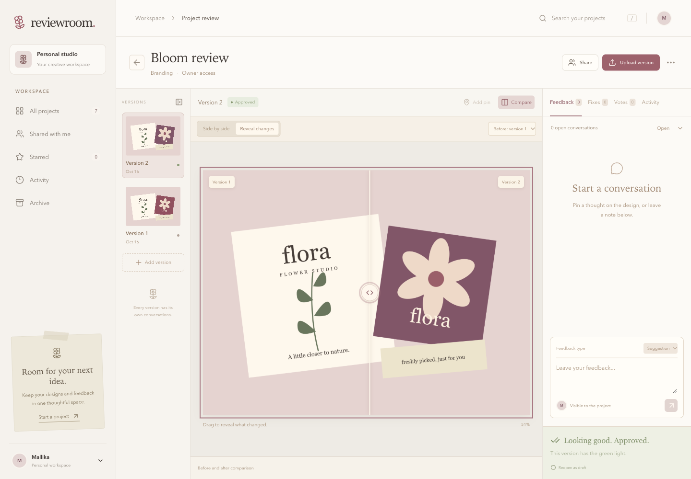
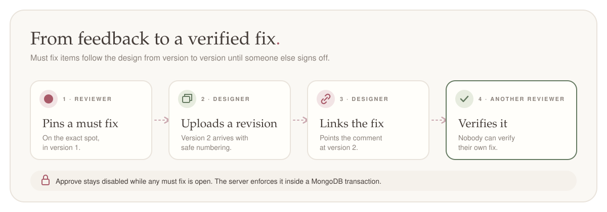
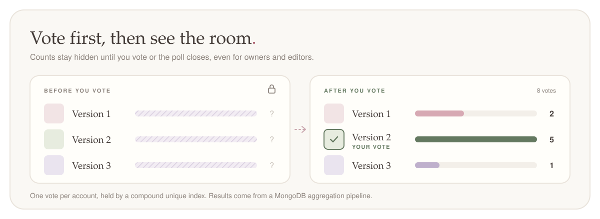
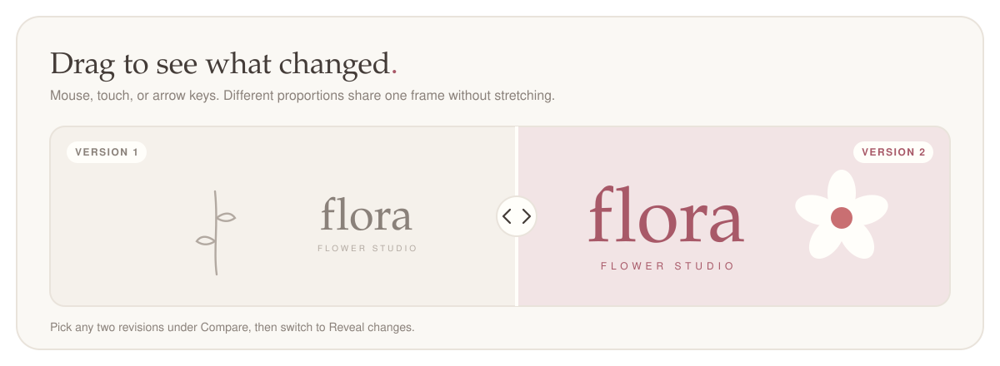
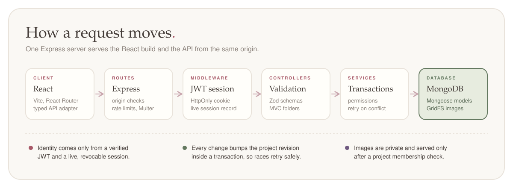

<p align="center">
  
</p>

# ReviewRoom

Upload a design, pin feedback exactly where it belongs, and follow each fix through to approval.

**Live at [reviewroom-xkzb.onrender.com](https://reviewroom-xkzb.onrender.com)** · MongoDB, Express, React, Node.js · made by [Mallika](https://github.com/snowhiteohno)

[A look inside](#a-look-inside) · [Features](#three-features-to-try) · [Run locally](#run-locally) · [Walkthrough](#try-a-review-together) · [How it works](#how-it-works) · [Syllabus map](#syllabus-map) · [Deploy](#deploy)

## A look inside

[](docs/images/studio.png)

Click any screenshot to see it at full size. Open a feature below for a closer look.

<details>
<summary><strong>Follow a comment from feedback to a verified fix</strong></summary>

A designer links a revision to a must fix. Another reviewer verifies the change before the project can be approved.

[](docs/images/fixes.png)

[Explore the feedback workflow](#feedback-to-fix)

</details>

<details>
<summary><strong>Vote on a design before seeing what everyone else chose</strong></summary>

Choose between two or three directions. Results stay hidden until you cast your vote or the poll closes.

[](docs/images/votes.png)

[Explore blind voting](#blind-design-voting)

</details>

<details>
<summary><strong>Reveal what changed between two versions</strong></summary>

Drag the comparison divider, or focus it and use the arrow keys, to reveal the revised design.

[](docs/images/reveal.png)

[Explore the comparison slider](#before-and-after-reveal)

</details>

## Three features to try

### Feedback to fix

<p align="center">
  
</p>

Feedback is a suggestion or a **must fix**. A designer links a later revision to show the fix, and a different reviewer verifies it. Must fixes stay visible across versions, and the server refuses approval until all of them are verified.

### Blind design voting

<p align="center">
  
</p>

Pick two or three versions and ask the team for a direction. Each account votes once, and nobody sees the counts until they vote or the poll closes.

### Before and after reveal

<p align="center">
  
</p>

Choose two revisions and drag the divider, or focus it and use the arrow keys. Images with different proportions are fitted to one frame without stretching.

### Also included

- **Accounts:** registration, login, logout and persistent sessions, with bcrypt hashes and JWTs in HttpOnly cookies.
- **Access:** protected routes, project membership, and owner, editor and reviewer roles.
- **Uploads:** private images with size, format and dimension checks, plus version history that numbers safely during concurrent uploads.
- **Feedback:** pinned comments that stay aligned while zooming, threaded replies, resolved discussions and side-by-side compare.
- **Studio:** categories, search, filters, favorites, grid and list views, archiving, and activity that refreshes while the page is visible.
- **Care:** loading, error and empty states, native dialogs and reduced motion support.

Each account gets a labeled sample studio, created once even if setup requests arrive together. Its artwork is original SVG kept in this repository.

| Layer          | Technology                                              |
| -------------- | ------------------------------------------------------- |
| Client         | React 19, TypeScript, Vite, React Router                |
| Styling        | CSS, system fonts, Lucide icons                         |
| Server         | Node.js, Express 5, MVC folders                         |
| Database       | MongoDB with Mongoose                                   |
| Authentication | bcrypt, jsonwebtoken, cookie-parser, revocable sessions |
| Uploads        | Multer, Sharp, MongoDB GridFS in production             |
| Validation     | Zod, Mongoose schemas, database indexes                 |
| Testing        | Node test runner, Supertest, Playwright                 |

## Run locally

Needs Node.js 22.13 or newer, plus either `mongod` on your PATH or a MongoDB Atlas cluster. No AI or paid API keys.

```sh
npm ci
npm run dev
```

Open **http://localhost:5174** and register. There are no built-in accounts or shared passwords.

When `MONGODB_URI` is empty, the dev script starts its own MongoDB replica set on port 27019 and leaves any other MongoDB alone. If a ReviewRoom instance is already on that port, it reuses it. The API runs on port 5180, and Vite proxies it so cookies stay on one origin.

<details>
<summary><strong>Use MongoDB Atlas instead</strong></summary>

Copy `.env.example` to `.env` and set `MONGODB_URI` to your Atlas connection string, then run `npm run dev`. Any replica set works. A standalone `mongod` does not, because ReviewRoom keeps feedback, approvals, membership, votes and version numbers consistent with transactions.

</details>

<details>
<summary><strong>Where local data lives</strong></summary>

| Path                   | Contents                             |
| ---------------------- | ------------------------------------ |
| `.data/mongo`          | Local MongoDB data                   |
| `.data/uploads`        | Private uploaded images              |
| `.data/session-secret` | Generated development signing secret |
| `.data/mongod.log`     | Local MongoDB logs                   |

These, along with `.env` files, test artifacts and screenshots, are ignored by Git. Data survives restarts.

</details>

## Try a review together

Use two browser profiles, one for a designer and one for a reviewer.

- [ ] Register both accounts.
- [ ] As the designer, create a project, upload a design, add the reviewer’s email under **Share**, and send them the copied link.
- [ ] As the reviewer, pin a **Must fix** on the design.
- [ ] As the designer, upload a revision, open **Fixes**, choose **Link a fix**, pick the revision, and request a review. Approval stays disabled.
- [ ] As the reviewer, verify the linked revision and approve.
- [ ] Open **Compare** and switch to **Reveal changes**.
- [ ] Open **Votes**, start a blind vote, and watch results appear after voting.

Short on time? The sample Flora project already has two revisions, an addressed fix and a blind vote.

## Roles

<details>
<summary><strong>Who can do what</strong></summary>

| Action                          | Owner | Editor                   | Reviewer |
| ------------------------------- | ----- | ------------------------ | -------- |
| View designs and feedback       | Yes   | Yes                      | Yes      |
| Comment and reply               | Yes   | Yes                      | Yes      |
| Upload revisions and link fixes | Yes   | Yes                      | No       |
| Request review or reopen draft  | Yes   | Yes                      | No       |
| Approve or request changes      | Yes   | No                       | Yes      |
| Verify another person’s fix     | Yes   | Original feedback author | Yes      |
| Manage access or archive        | Yes   | No                       | No       |
| Start a blind vote              | Yes   | Yes                      | No       |
| Vote once in a poll             | Yes   | Yes                      | Yes      |
| Close a poll                    | Yes   | Poll creator             | No       |

- Nobody can verify their own fix.
- An owner, an editor or the author can resolve a suggestion directly. A must fix always needs the linked-revision verification.
- Sharing records access and sends no email. The teammate registers or signs in with the email you added.
- Removing someone cuts off their access to files and project actions immediately.

</details>

## How it works

<p align="center">
  
</p>

- **Identity.** The server loads the account from a verified JWT and a live session record and ignores identity headers sent by the client. Logout deletes the session, so replaying an old cookie fails.
- **Data.** Projects embed their membership. Versions, comments, polls, votes, favorites and activity reference their parent records through Mongoose models.
- **Consistency.** Every project mutation writes the project revision first, inside a transaction, so concurrent writes conflict and retry. Approval checks and fix verification share that transaction, so a competing blocker can’t slip through.
- **Versions.** Numbers come from a transaction-protected project counter backed by a unique index. If the database write fails, the stored image is removed.
- **Files.** Uploads live outside the public directory and are returned only after an access check.
- **Pins.** Coordinates are stored from 0 to 1 relative to the image, so pins stay aligned as the canvas resizes and zooms.

## Syllabus map

| MERN concept                      | Where ReviewRoom uses it                                                |
| --------------------------------- | ----------------------------------------------------------------------- |
| React components and props        | Studio, review canvas, forms, and reusable feedback components          |
| Controlled forms and validation   | Registration, login, projects, feedback, voting, and sharing            |
| Hooks, refs, and events           | Pin placement, canvas zoom, comparison slider, and refresh logic        |
| Context and protected routing     | AuthProvider and React Router login redirects                           |
| Fetch and REST APIs               | Client requests to Express routes                                       |
| Node.js and environment variables | Runtime configuration, development tools, and private file storage      |
| Express MVC and middleware        | Routes, controllers, authentication, origin checks, uploads, and errors |
| MongoDB and Mongoose              | Models, validation, references, indexes, and queries                    |
| Aggregation                       | Grouping blind votes into result counts                                 |
| Authentication and authorization  | bcrypt, JWTs, HttpOnly cookies, sessions, and project roles             |
| CRUD and business rules           | Projects, members, feedback states, revisions, and approvals            |
| Transactions and concurrency      | Safe version numbering, approval gates, and duplicate voting protection |

<details>
<summary><strong>REST API</strong></summary>

| Method       | Endpoint                              | Purpose                                       |
| ------------ | ------------------------------------- | --------------------------------------------- |
| POST         | /api/auth/register                    | Create an account                             |
| POST         | /api/auth/login                       | Start a session                               |
| GET          | /api/auth/me                          | Read the signed-in account                    |
| POST         | /api/auth/logout                      | Revoke the current session                    |
| GET          | /api/studio                           | List accessible projects and activity         |
| POST         | /api/studio                           | Initialize a sample studio once               |
| POST         | /api/projects                         | Create a project                              |
| GET          | /api/projects/:id                     | Read a project, versions, feedback, and polls |
| PATCH        | /api/projects/:id                     | Edit or archive a project                     |
| PUT          | /api/projects/:id/favorite            | Change a personal favorite                    |
| POST, DELETE | /api/projects/:id/members             | Add, update, or remove access                 |
| POST         | /api/projects/:id/upload              | Upload a revision                             |
| GET          | /api/assets/:id                       | Read an authorized image                      |
| POST         | /api/projects/:id/comments            | Add feedback or a reply                       |
| PATCH        | /api/projects/:id/comments/:commentId | Resolve, reopen, address, or verify feedback  |
| POST         | /api/projects/:id/review              | Request review or make a review decision      |
| POST         | /api/projects/:id/polls               | Start a design vote                           |
| POST         | /api/projects/:id/polls/:pollId/votes | Cast one vote                                 |
| PATCH        | /api/projects/:id/polls/:pollId/close | Close voting and reveal results               |

</details>

<details>
<summary><strong>Source layout</strong></summary>

```text
client/src/
  App.tsx, AuthPage.tsx      Routing and authentication screens
  Studio.tsx, Review.tsx     Project board and review canvas
  components/                Forms, feedback flow, design votes, comparison
  lib/                       Auth context, typed data, API adapter
server/
  config/                    Environment and MongoDB setup
  models/                    Mongoose schemas and indexes
  controllers/               Authentication and product operations
  middleware/                JWT sessions and request origin checks
  routes/                    Express endpoints
  services/                  Authorization, transactions, samples, vote results
  utils/                     Validation and error responses
scripts/
  dev.mjs, mongo.mjs         Local development and database startup
  ui-check.mjs               Two-account browser verification
tests/
  api.test.mjs               MongoDB and Express integration tests
docs/art/                    README illustrations
```

</details>

## Tests

```sh
npm run typecheck
npm run build
npm test
```

The API suite runs Supertest against a real MongoDB replica set. It creates a uniquely named `reviewroom_test` database, checks the name before cleanup, and drops only that database. It covers password hashing, session revocation, access control, private files, GridFS persistence and cleanup, concurrent uploads, feedback isolation, independent verification, approval races, blind voting, cross-project options, membership removal and idempotent sample setup.

For the browser suite, keep `npm run dev` running, start Chrome with remote debugging, and run:

```sh
npm run test:ui
```

`CHROME_CDP_URL` defaults to `http://localhost:9222` and `UI_BASE_URL` to `http://localhost:5174`. A designer and a reviewer, each in their own browser context, go through registration, login and logout, uploads, sharing, linked fixes, approval blocking, verification, voting, keyboard slider controls, mobile layout, and persistence after signing in again. Screenshots land in `artifacts`. Test accounts use `reviewroom.test` emails, and their project is archived after a passing run.

## Deploy

### Render

The live app runs from the included `render.yaml`. [Create your own Render deployment](https://render.com/deploy?repo=https://github.com/snowhiteohno/reviewroom) with a personal Render account.

1. In MongoDB Atlas, create a cluster and a database user with read and write access. Under Network Access, allow Render’s outbound IP addresses, or allow access from anywhere and rely on a strong password.
2. Create the Blueprint and paste the Atlas connection string as `MONGODB_URI`, with `/reviewroom` as the database name. Keep it in Render, never in the repository.
3. Render installs dependencies, builds React, generates `JWT_SECRET` and starts Express on the free plan, with GridFS storage and `/api/health` as the readiness check.
4. Open the HTTPS address Render shows and register. `RENDER_EXTERNAL_URL` is read automatically. Set `APP_ORIGIN` if you add a custom domain.

The blueprint sets `TRUST_PROXY_HOPS=1` so the server trusts Render’s proxy. Keep it at 0 when Node is served directly. Free services sleep when idle, so the first request afterwards is slow.

### Anywhere else

```sh
npm run build
NODE_ENV=production npm start
```

Set `MONGODB_URI`, `APP_ORIGIN` and a random `JWT_SECRET` of at least 32 characters. `APP_ORIGIN` must be HTTPS because production auth cookies require it. Express serves the built client and the API from one origin.

Production uploads default to GridFS, so images survive redeploys and still need project membership to download. Development defaults to the filesystem. Set `UPLOAD_STORAGE` to `gridfs` or `filesystem` to choose. Filesystem hosting needs a persistent `UPLOAD_DIR` outside public static files.

The Dockerfile runs as an unprivileged user, includes a database-aware health check, and contains no credentials or secrets. Pass the same three variables at runtime.

## Scope

This release reviews images and screenshots. Email delivery, email verification, password recovery, PDF markup and video review are outside this version.

[Back to the top](#reviewroom)
