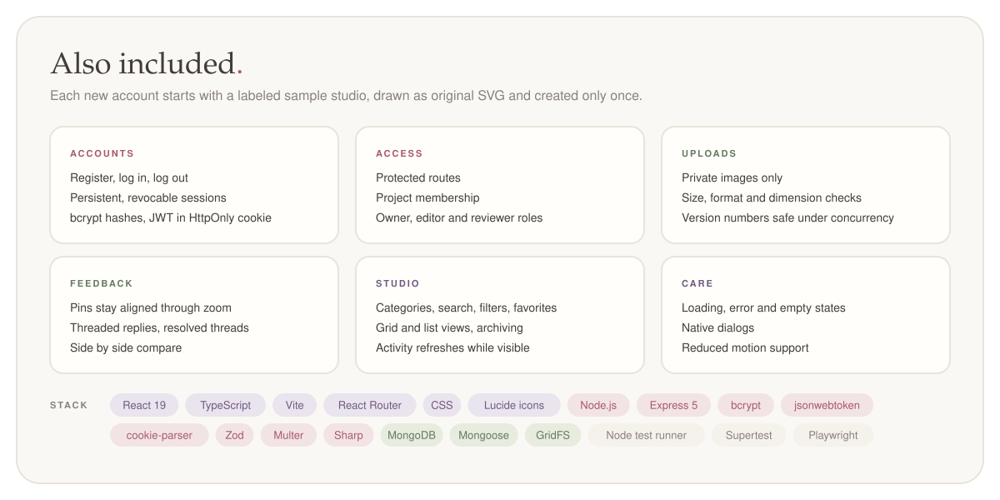
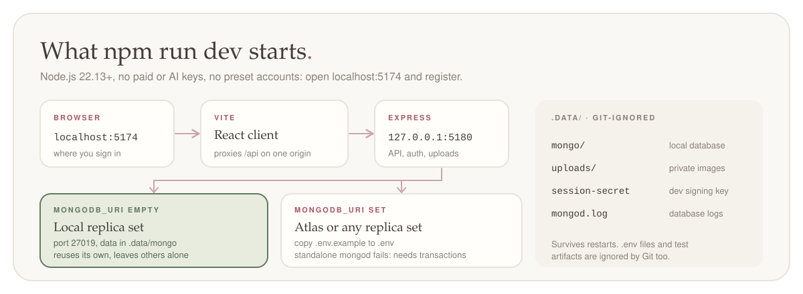
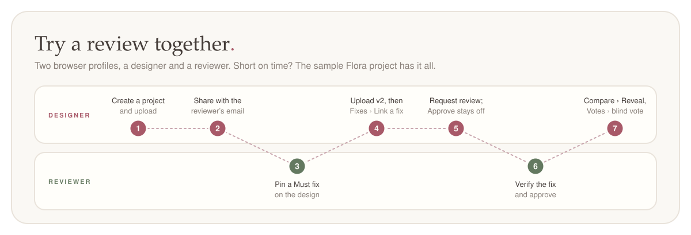
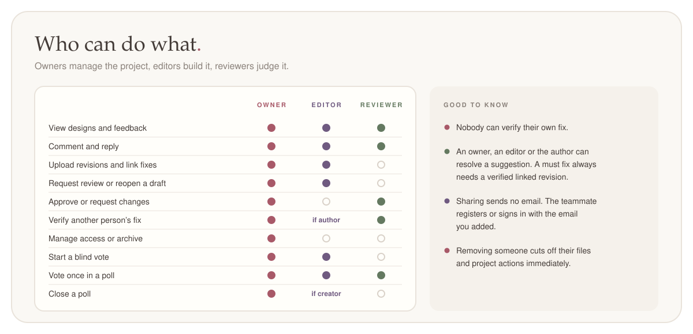
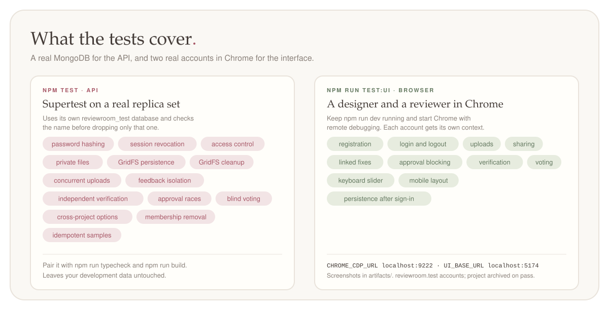
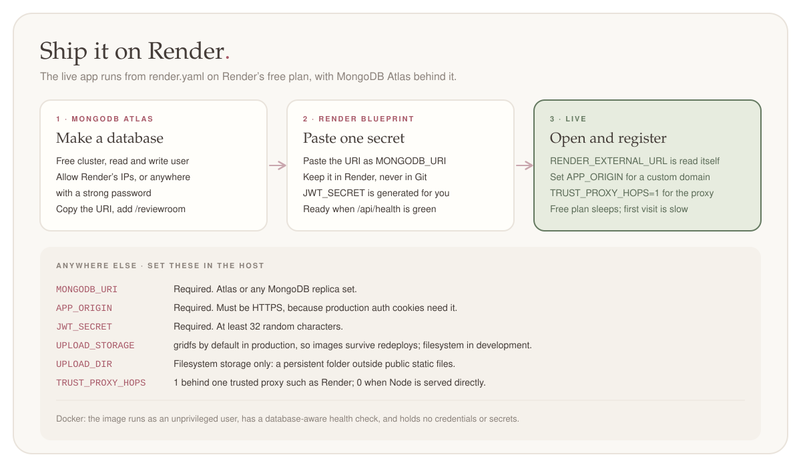

<p align="center">
  
</p>

# ReviewRoom

**Live at [reviewroom-xkzb.onrender.com](https://reviewroom-xkzb.onrender.com)** · made by [Mallika](https://github.com/snowhiteohno)

[A look inside](#a-look-inside) · [Features](#three-features-to-try) · [Run locally](#run-locally) · [Walkthrough](#try-a-review-together) · [Roles](#roles) · [How it works](#how-it-works) · [Syllabus map](#syllabus-map) · [Tests](#tests) · [Deploy](#deploy)

## A look inside

[](docs/images/studio.png)

Click any screenshot to see it at full size. Open a feature below for a closer look.

<details>
<summary><strong>Follow a comment from feedback to a verified fix</strong></summary>

A designer links a revision to a must fix. Another reviewer verifies the change before the project can be approved.

[](docs/images/fixes.png)

[Explore the feedback workflow](#feedback-to-fix)

</details>

<details>
<summary><strong>Vote on a design before seeing what everyone else chose</strong></summary>

Choose between two or three directions. Results stay hidden until you cast your vote or the poll closes.

[](docs/images/votes.png)

[Explore blind voting](#blind-design-voting)

</details>

<details>
<summary><strong>Reveal what changed between two versions</strong></summary>

Drag the comparison divider, or focus it and use the arrow keys, to reveal the revised design.

[](docs/images/reveal.png)

[Explore the comparison slider](#before-and-after-reveal)

</details>

## Three features to try

### Feedback to fix

<p align="center">
  
</p>

### Blind design voting

<p align="center">
  
</p>

### Before and after reveal

<p align="center">
  
</p>

### Also included

<p align="center">
  
</p>

## Run locally

```sh
npm ci
npm run dev
```

<p align="center">
  
</p>

## Try a review together

<p align="center">
  
</p>

## Roles

<p align="center">
  
</p>

## How it works

<p align="center">
  
</p>

## Syllabus map

| MERN concept                      | Where ReviewRoom uses it                                                |
| --------------------------------- | ----------------------------------------------------------------------- |
| React components and props        | Studio, review canvas, forms, and reusable feedback components          |
| Controlled forms and validation   | Registration, login, projects, feedback, voting, and sharing            |
| Hooks, refs, and events           | Pin placement, canvas zoom, comparison slider, and refresh logic        |
| Context and protected routing     | AuthProvider and React Router login redirects                           |
| Fetch and REST APIs               | Client requests to Express routes                                       |
| Node.js and environment variables | Runtime configuration, development tools, and private file storage      |
| Express MVC and middleware        | Routes, controllers, authentication, origin checks, uploads, and errors |
| MongoDB and Mongoose              | Models, validation, references, indexes, and queries                    |
| Aggregation                       | Grouping blind votes into result counts                                 |
| Authentication and authorization  | bcrypt, JWTs, HttpOnly cookies, sessions, and project roles             |
| CRUD and business rules           | Projects, members, feedback states, revisions, and approvals            |
| Transactions and concurrency      | Safe version numbering, approval gates, and duplicate voting protection |

<details>
<summary><strong>REST API</strong></summary>

| Method       | Endpoint                              | Purpose                                       |
| ------------ | ------------------------------------- | --------------------------------------------- |
| POST         | /api/auth/register                    | Create an account                             |
| POST         | /api/auth/login                       | Start a session                               |
| GET          | /api/auth/me                          | Read the signed-in account                    |
| POST         | /api/auth/logout                      | Revoke the current session                    |
| GET          | /api/studio                           | List accessible projects and activity         |
| POST         | /api/studio                           | Initialize a sample studio once               |
| POST         | /api/projects                         | Create a project                              |
| GET          | /api/projects/:id                     | Read a project, versions, feedback, and polls |
| PATCH        | /api/projects/:id                     | Edit or archive a project                     |
| PUT          | /api/projects/:id/favorite            | Change a personal favorite                    |
| POST, DELETE | /api/projects/:id/members             | Add, update, or remove access                 |
| POST         | /api/projects/:id/upload              | Upload a revision                             |
| GET          | /api/assets/:id                       | Read an authorized image                      |
| POST         | /api/projects/:id/comments            | Add feedback or a reply                       |
| PATCH        | /api/projects/:id/comments/:commentId | Resolve, reopen, address, or verify feedback  |
| POST         | /api/projects/:id/review              | Request review or make a review decision      |
| POST         | /api/projects/:id/polls               | Start a design vote                           |
| POST         | /api/projects/:id/polls/:pollId/votes | Cast one vote                                 |
| PATCH        | /api/projects/:id/polls/:pollId/close | Close voting and reveal results               |

</details>

<details>
<summary><strong>Source layout</strong></summary>

```text
client/src/
  App.tsx, AuthPage.tsx      Routing and authentication screens
  Studio.tsx, Review.tsx     Project board and review canvas
  components/                Forms, feedback flow, design votes, comparison
  lib/                       Auth context, typed data, API adapter
server/
  config/                    Environment and MongoDB setup
  models/                    Mongoose schemas and indexes
  controllers/               Authentication and product operations
  middleware/                JWT sessions and request origin checks
  routes/                    Express endpoints
  services/                  Authorization, transactions, samples, vote results
  utils/                     Validation and error responses
scripts/
  dev.mjs, mongo.mjs         Local development and database startup
  ui-check.mjs               Two-account browser verification
tests/
  api.test.mjs               MongoDB and Express integration tests
docs/art/                    README illustrations
```

</details>

## Tests

```sh
npm run typecheck
npm run build
npm test
npm run test:ui   # with npm run dev running and Chrome on port 9222
```

<p align="center">
  
</p>

## Deploy

[Create your own Render deployment](https://render.com/deploy?repo=https://github.com/snowhiteohno/reviewroom), or build and start it anywhere:

```sh
npm run build
NODE_ENV=production npm start
```

<p align="center">
  
</p>

## Scope

This release reviews images and screenshots. Email delivery, email verification, password recovery, PDF markup and video review are outside this version.

[Back to the top](#reviewroom)
